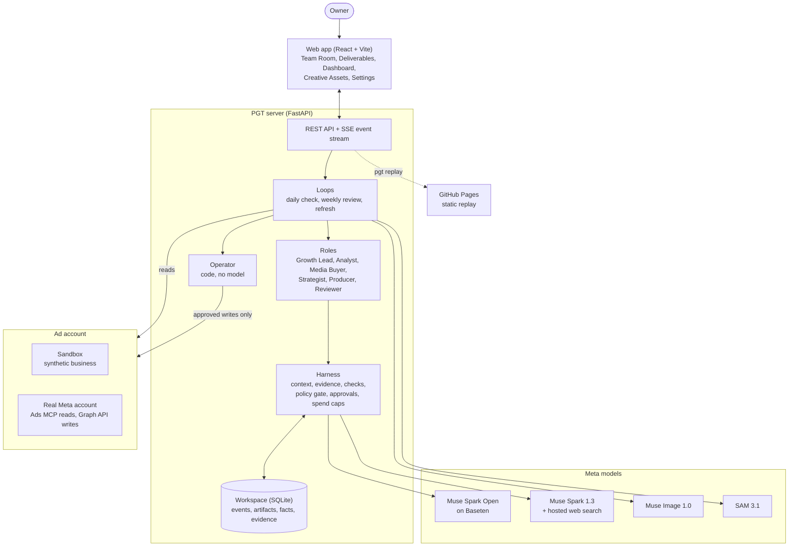
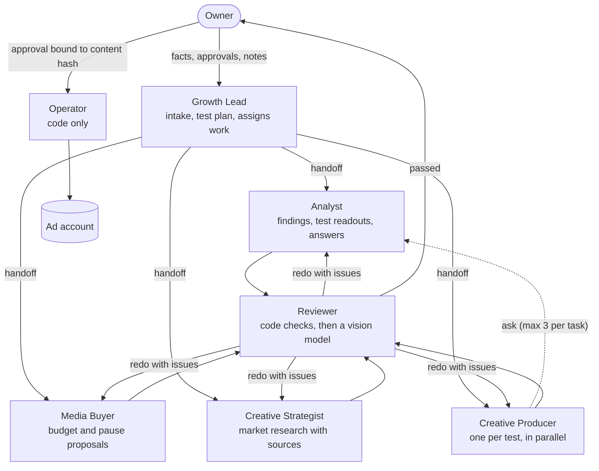
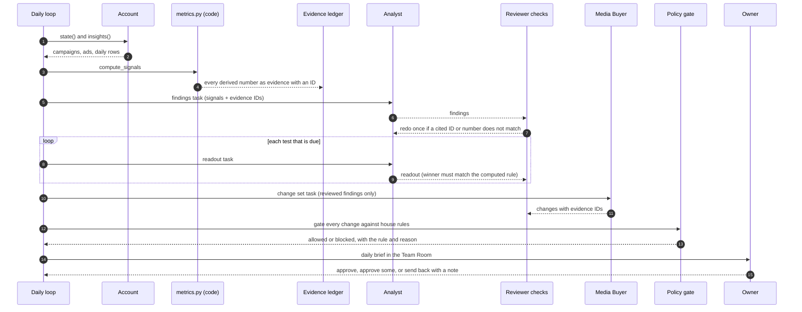
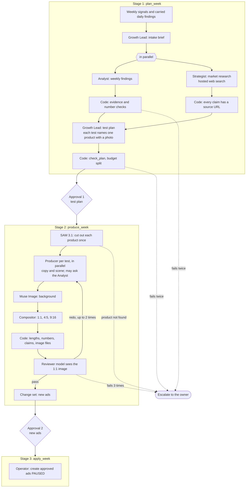
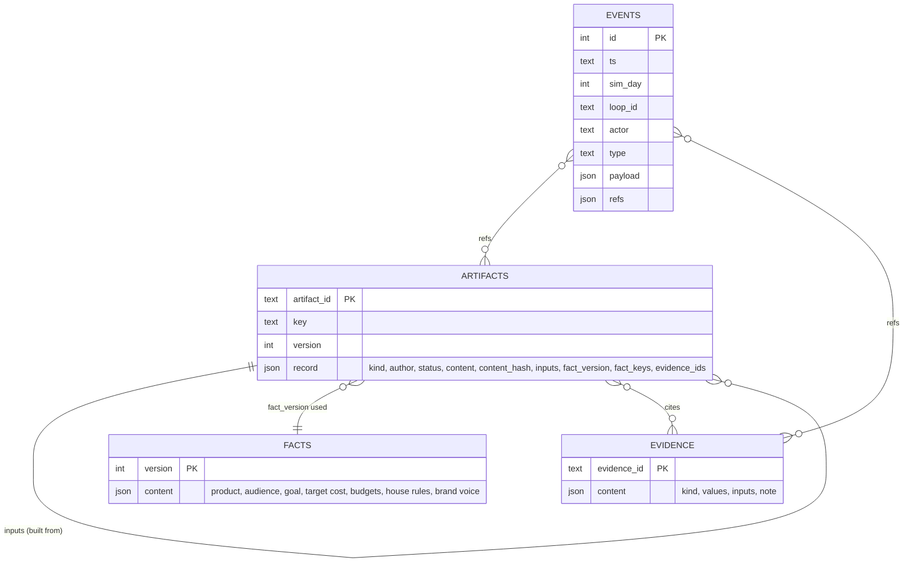
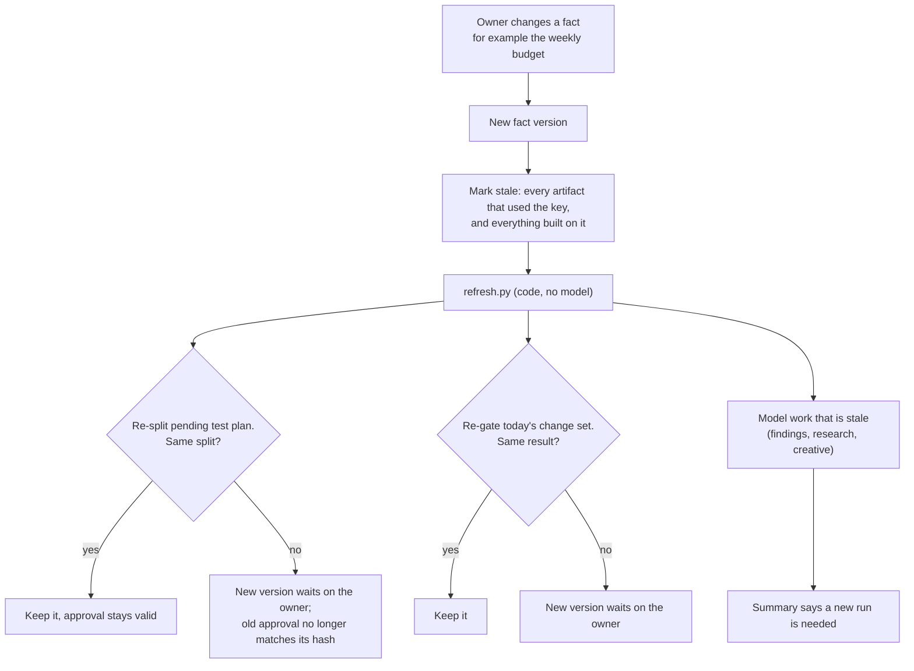
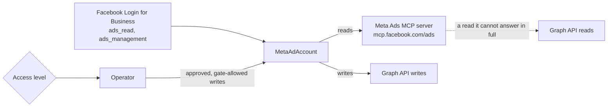
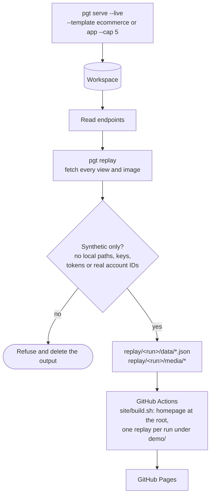

# Architecture

Pallas Growth Team (PGT) is a small team of AI roles that runs Meta ads for one advertiser. The roles are language-model agents. Everything that decides whether their work is safe to use is ordinary code: the numbers they may quote, the tools they may call, the house rules a budget change must pass, the approval a write needs, and the money a run may spend.

This page shows how the pieces fit. Two companion pages go deeper:

- [harness.md](harness.md): the guarantees the harness enforces, where each one lives in code, and the tests and bench scenarios that prove it.
- [meta-models.md](meta-models.md): which Meta model each role runs on and why, the creative image pipeline, and the Meta ads integration.

Measured results are in [BENCH_RESULTS.md](BENCH_RESULTS.md) (offline, 9 arms), [LIVE_RESULTS.md](LIVE_RESULTS.md) (live, on Muse) and [HARNESS_COMPARISON.md](HARNESS_COMPARISON.md) (PGT against the OpenAI Agents SDK, LangGraph and a single agent).

## System overview

A run is driven by loops. A loop gathers data from the account, hands tasks to roles, checks what comes back, and publishes typed deliverables to the workspace. The owner sees every step in the Team Room, which is a live view of the event log, and approves or sends back the deliverables that would change the account.

## Code map

| Package | What it holds |
| --- | --- |
| `pgt.loops` | `daily.py` (daily check), `weekly.py` (weekly review in three stages), `refresh.py` (re-runs only what a fact change made stale), `kickoff.py` (first message after connecting an account), `simulate.py` |
| `pgt.roles` | One module per role: prompt, typed output and inputs. `metrics.py` computes every derived number in code, so no role does arithmetic. `operator.py` is the only writer |
| `pgt.harness` | `events.py` (append-only log), `artifacts.py` (versioned deliverables with stale propagation), `facts.py` (versioned shared facts), `ledger.py` + `verify.py` (evidence and number checks), `creative_checks.py`, `policy.py` (tool allowlist, house-rule gate, spend caps), `approvals.py` (hash-bound approvals), `protocol.py` (handoff, ask/answer, escalation), `context.py` (context assembly), `access.py` (L0 to L2) |
| `pgt.llm` | `runtime.py` (runs a role as a Pydantic AI agent inside the harness), `routing.py` (model per role), `meta.py` and `baseten.py` (providers), `media.py` (Muse Image and SAM 3.1), `offline.py` and `fake.py` (deterministic stand-ins for tests) |
| `pgt.creative` | `compose.py`: SAM cutout, layout and rendering of the three ad sizes |
| `pgt.ads` | `meta_account.py` (a real account behind the sandbox interface), `ads_mcp.py` (Meta Ads MCP client), `graph.py` (Graph API client), `meta_login.py` (Facebook Login for Business) |
| `pgt.sandbox` | Synthetic businesses (an indie fitness app and a pet-supplies store) with simulated delivery |
| `pgt.schemas` | Pydantic models for every deliverable. Model-returned types use strict JSON schema |
| `pgt.api` | `app.py` (routes), `views.py` (Team Room, Dashboard), `board.py` (Deliverables, Creative Assets) |
| `pgt.replay` | Records a running team as a static, read-only site |
| `web/` | React 18 + TypeScript front end. A `replay` build mode reads JSON files instead of the API |
| `bench/` | The offline and live harness comparison (9 arms, 6 scenarios) |

## The team

| Role | Runs on | Output | Tools it may call |
| --- | --- | --- | --- |
| Growth Lead | Muse Spark Open | Weekly brief, test plan | `get_account_state`, `get_evidence` |
| Analyst | Muse Spark Open | Findings, test readouts, answers to the Producer | `get_account_state`, `get_insights`, `get_evidence` |
| Media Buyer | Muse Spark Open | Change set draft (budgets, pauses) | `get_account_state`, `get_insights`, `get_evidence` |
| Creative Strategist | Muse Spark 1.3 on the Meta API | Market research, every claim with a source URL | `web_search` (hosted) |
| Creative Producer | Muse Spark Open | Ad copy, image scene prompt | `ask_analyst` |
| Reviewer | Code, then Muse Spark Open with the image attached | Verdict with one line per fix | `get_evidence` |
| Operator | Code | Execution receipt | none; it is the only component that writes to the account |

Only the Growth Lead (or the loop itself) can assign work. A role can ask one other role a question, one hop deep, at most three times per task, and the answer is checked against the evidence before the asker sees it. A role can propose a change to the shared facts, but only the owner can apply it.

## Daily check

Every simulated or real day, the team reads yesterday's results and decides whether anything should change.

The Media Buyer only sees findings that passed review. A change the gate blocks stays visible in the brief with the rule it broke, so the owner knows what was considered and why it was held back. Overriding a failed rule takes the rule's name and a second confirmation.

## Weekly review

The weekly review makes new ads. It runs in three stages, split by the owner's two approvals. Each stage refuses to run without a valid approval of the stage before it.

Every redo carries the exact issues the checks found, so the role fixes those and nothing else. When a stage cannot finish, the team escalates with a plain reason instead of shipping something weaker.

## Workspace and data model

All state lives in one SQLite file per workspace. The event log is append-only, enforced by database triggers, and every store writes its change and the matching event in one transaction. The Team Room, the dashboard and the replay are all views of this file.

- **Artifacts** are typed deliverables (findings, change set, test plan, creative set, brief). Publishing under an existing key makes a new version; the old one is kept. Each record lists the artifacts it was built from and the facts it used, so a fact change marks exactly the right deliverables stale, transitively.
- **Facts** are versioned. Only the owner and the Growth Lead may set them.
- **Evidence** is write-once: re-adding an ID with different content is an error, so a number can never silently change under a claim that cites it.
- **Events** record everything else: every model call with its token counts, cost, context hash and fact version; every tool call and blocked tool call; handoffs, questions and answers; approvals, voided approvals and writes.

In the live e-commerce run recorded for the public demo (14 days, one full weekly review), the log holds 117 model calls, 126 tool calls, 337 evidence entries and 83 published deliverables.

## When a fact changes

This works like a build system: redo the cheap, mechanical part, stop where a rebuilt input comes out identical, and never spend a model call to find out.

## Real ad accounts

The same loops run against a real Meta ad account. `MetaAdAccount` implements the sandbox interface, so no loop knows which one it has.

| Level | What the team may do |
| --- | --- |
| L0 Observe | Read results and write findings. Proposes nothing. |
| L1 Propose | Draft test plans, creative and change sets. The owner applies them in Ads Manager. |
| L2 Apply after approval | The Operator writes exactly what was approved. On a real account new ads are created paused inside an existing ad set, an ad can be paused but never turned on, and a budget changes only on an ad set that owns its daily budget, checked on the live ad set right before the write. |

The API checks the level before it accepts an approval, and the Operator checks it again before it writes. A write Meta refuses is recorded on the receipt; the Operator never retries or works around a refusal.

## The public replay

The public site is a homepage plus two recordings of real live runs, served as static files: Northpaw Supply, a pet-supplies store (`--template ecommerce`), and Pallas Fit, a fitness app starting cold (`--template app --cold`). It calls no model and holds no key.

The replay build of the web app maps each API path to a JSON file (`/api/dashboard?days=7` becomes `data/dashboard-7.json`) and hides every control that would write.

## Testing

- `uv run pytest`: 200 tests. Unit tests cover each harness component; acceptance tests run whole daily and weekly loops on the offline model; API tests drive the FastAPI app and the replay export.
- The offline model (`pgt.llm.offline`) is deterministic and can plant specific mistakes (a wrong number, an unsupported claim, an injected instruction), so the tests prove the harness catches them rather than hoping the model avoids them.
- The Meta Ads MCP, the Graph API and both model providers are behind injectable transports, so no test touches the network.
- `bench/` runs the same scenarios against PGT, five ablations, a single agent, an OpenAI Agents SDK team and a LangGraph team. See [BENCH_RESULTS.md](BENCH_RESULTS.md).
