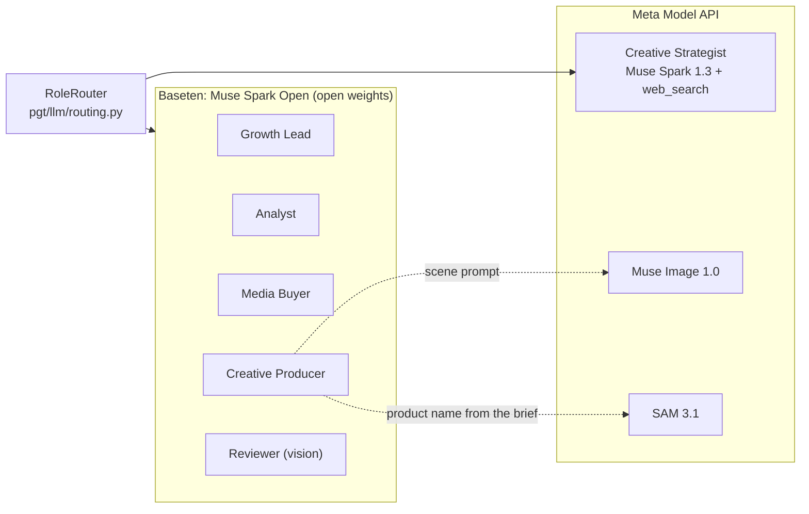
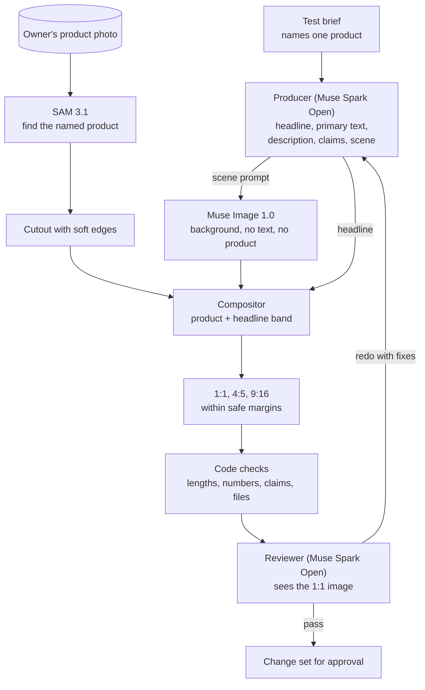

# Meta models and products

PGT is built on Meta's stack end to end: Muse models think, write and review; Muse Image and SAM 3.1 make the ads; the Meta Ads MCP server and the Marketing API connect the team to a real ad account. This page shows which part runs where, why, and what it cost on a recorded live run.

## What PGT uses

| Meta product | Used for | Code |
| --- | --- | --- |
| Muse Spark Open (`muse-spark-open-1026`, open weights, served on Baseten) | Every text role except the Strategist: Growth Lead, Analyst, Media Buyer, Creative Producer, and the Reviewer with an image attached | `pgt/llm/baseten.py` |
| Muse Spark 1.3 on the Meta Model API | The Creative Strategist, because it needs hosted web search with citations | `pgt/llm/meta.py`, `pgt/roles/strategist.py` |
| Hosted web search on the Meta Model API | Current competitor and category examples, each claim with a source URL | `pgt/roles/strategist.py` |
| Muse Image 1.0 | Ad backgrounds: a scene with no text and no product | `pgt/llm/media.py` |
| SAM 3.1 | Finds the advertised product in the owner's real photo so it can be cut out exactly | `pgt/llm/media.py`, `pgt/creative/compose.py` |
| Meta Ads MCP server (`mcp.facebook.com/ads`) | Reads from a real ad account: campaigns, ad sets, ads, insights | `pgt/ads/ads_mcp.py` |
| Marketing API (Graph API) | Reads the MCP cannot answer in full, and every write | `pgt/ads/graph.py`, `pgt/ads/meta_account.py` |
| Facebook Login for Business | The owner connects an ad account: `ads_read` and `ads_mcp_management` for reads, `ads_management` for writes at L2. The token stays in memory and is never written to the workspace | `pgt/ads/meta_login.py` |

## Model per role

Routing is one small table. `RoleRouter` maps a role name to a Pydantic AI model; roles listed in `META_ONLY` (today only the Strategist) go to the Meta API, everything else to the default. `pgt serve --provider meta` puts every role on the Meta API instead, and the offline model replaces both for tests and the bench.

Muse Spark Open runs at a configurable reasoning effort (`--effort`, default `medium`). Baseten returns the reasoning in `reasoning_content` and already counts reasoning tokens as output, so the logged cost covers them.

## What one live run cost

The public demo is a recording of this run: the pet-supplies store, 14 days of daily checks and one full weekly review with three new ads. Costs are list-price estimates from each call's token counts, logged as the run happened.

| Model | Role | Calls | Web searches | Cost (USD) |
| --- | --- | --- | --- | --- |
| Muse Spark Open | Analyst | 64 | | 0.4629 |
| Muse Spark Open | Media Buyer | 27 | | 0.1460 |
| Muse Spark Open | Creative Producer | 12 | | 0.0864 |
| Muse Spark Open | Growth Lead | 4 | | 0.0534 |
| Muse Spark Open | Reviewer | 3 | | 0.0238 |
| Muse Spark 1.3 | Creative Strategist | 2 | 21 | 0.3339 |
| Muse Image 1.0 | Creative Producer | 3 | | 0.0300 |
| SAM 3.1 | Creative Producer | 2 | | 0.0050 |
| **Total** | | **117** | **21** | **1.1414** |

Two weeks of an always-on growth team for about a dollar. The 14 daily checks made 81 of the calls and cost $0.51 together, under four cents a day. The Week 1 review, from market research to three reviewed ads, cost $0.40. Planning Week 2 cost $0.23 so far; it is waiting on the owner's approval.

## How an ad is made

The product in the ad is always the owner's real product, cut from their own photo. Muse Image only paints the setting around it, and the words are set in code, so an image model never invents a product detail or misspells a headline.

Each product is segmented once per week and shared by every test that shows it. If SAM 3.1 cannot find the product the brief names, the week stops and the owner is told why, rather than shipping an ad with the wrong product.

## Why Meta's models matter here

**Open weights make an always-on team affordable and portable.** A growth team that checks the account every day runs hundreds of model calls a month for one small business. In this run the daily checks, all on Muse Spark Open, cost under four cents a day, and because the weights are open the same team can move to another host, or to the owner's own infrastructure, without changing a prompt. The routing table is the only thing that changes.

**One model family for planning, tools, structured output and vision.** The same Muse model drafts a test plan, calls account tools, returns strict JSON every deliverable depends on, and reviews a rendered ad by looking at it. That keeps behavior consistent across roles and lets the harness treat every role the same way.

**Hosted web search with citations makes market claims checkable.** The Strategist's research comes back with the URLs the search actually found, and the harness only lets ad copy cite those. A claim about the market is either linked to a real page or it does not ship.

**SAM 3.1 keeps the product real.** For an e-commerce seller the product in the ad has to be the product they ship. Segmenting the owner's own photo, instead of generating the product, removes a whole class of misleading-ad risk, and Muse Image still gives each test a fresh setting.

**Meta's own ads interfaces close the loop.** The official Ads MCP server reads the account, the Marketing API writes only what the owner approved, and Facebook Login for Business scopes access to exactly the account and permissions the owner grants. The team can go from reading results to proposing and creating paused ads without leaving Meta's platform.

## Data handling

- The public demo runs on synthetic sandbox businesses only. The replay export refuses local paths, anything shaped like a key or token, and real ad account IDs.
- Real ad data is never sent to a `-contributor` model: the server refuses to connect a real account when the team runs on one.
- Keys are read from the environment and never logged; errors from Meta carry Meta's message but never the access token.
